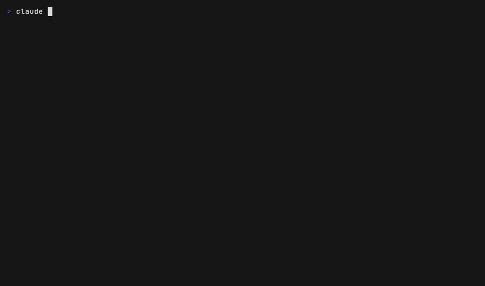

# 🧘 vibestretch

A stretch and break reminder plugin for developers. It nudges you to move while Claude Code, Codex CLI or Gemini CLI runs a long turn.

```
claude plugin marketplace add Eliasjunit/vibestretch && claude plugin install vibestretch@vibestretch
```

That one command installs it in Claude Code. [Codex CLI](#install-codex-cli) and [Gemini CLI](#install-gemini-cli) are below.



Your coding agent works for minutes at a time. You sit there, slouched, not blinking.
vibestretch uses that wait time for your spine and eyes:

```
🧘 Wrist circles, 10 each way. Your tendons will thank you. · vibestretch · 7 min of agent time
```

Website with guides in 30 languages: [eliasjunit.github.io/vibestretch](https://eliasjunit.github.io/vibestretch/)

## Why it has no timer

A break timer runs on a schedule. It lands whenever it lands, often mid-thought.
That is why most people end up turning them off.

vibestretch has no schedule. It counts one thing: the minutes an agent turn kept
you waiting at the machine. It speaks inside that wait and nowhere else. A day of
quick turns says nothing at all. There is nothing to snooze, because it never
interrupts your own work.

The nudge reaches you several ways, because you are rarely looking at the right
spot when it fires:

- a line in the session, for when you watch the agent work
- a soft chime of its own (bundled, nothing system-sounding), for when you are
  not looking at any screen
- a notification banner (Warp, Ghostty, iTerm2, WezTerm, kitty; in VS Code only
  if you add a notifier extension), for the moment it fires. What your terminal
  does with it varies, see [How it works](#how-it-works)
- your status line, if you run [`/vibestretch:statusline`](#show-it-in-your-status-line).
  This is the one channel still there when you come back from another app

All out of the box, nothing to configure. `VIBESTRETCH_SOUND=0` mutes the
sound. `VIBESTRETCH_NOTIFY=0` drops the banner.

Twelve exercises ship with it: stretches, micro-workouts and eye breaks
(20-20-20 and friends). They rotate, so you never get the same one twice in a row.
Swap them for [your own list](#your-own-exercises) if you prefer.

## Install (Claude Code)

From your shell:

```
claude plugin marketplace add Eliasjunit/vibestretch && claude plugin install vibestretch@vibestretch
```

Or inside Claude Code:

```
/plugin marketplace add Eliasjunit/vibestretch
/plugin install vibestretch@vibestretch
```

That's it. No dependencies, no daemon, no telemetry, no ads, no links in your terminal.
It is a few small POSIX shell scripts (plus one bundled sound file, nudge.wav) wired into Claude Code hooks.
Nothing ever leaves your machine.

## Install (Codex CLI)

```
codex plugin marketplace add Eliasjunit/vibestretch
codex plugin add vibestretch@vibestretch
```

Codex doesn't run a plugin's hooks until you have reviewed them. Open
`/hooks` and trust the three vibestretch entries. Until then the plugin is
installed but silent.

Rather not use the plugin system? A clone and a config file do the same job:

```
git clone https://github.com/Eliasjunit/vibestretch ~/.codex/vibestretch
cp ~/.codex/vibestretch/hooks/codex-hooks.json ~/.codex/hooks.json
```

Already have a `~/.codex/hooks.json`? Merge the three entries from ours into it.
Do not overwrite yours. Codex asks you to trust a new hook config the first time
it runs. That prompt is expected.

Pick one of the two ways. With the plugin and the hand-made entries both in
place, every hook runs twice. If you installed by hand before 0.8.0, remove our
entries from `~/.codex/hooks.json` when you switch to the plugin.

What differs from Claude Code: you get the line in the session and the chime.
There is no notification banner. Codex parses hook output strictly and drops the
whole object if it contains a field it doesn't know. It has no field for a
terminal sequence, so sending one would cost you the nudge itself. There's no
status line segment either. That bar isn't scriptable in Codex.

The debt is shared across CLIs, deliberately. An hour of waiting is an hour of
waiting, whichever agent kept you in the chair.

## Install (Gemini CLI)

Hooks ship enabled since Gemini CLI v0.26. Clone, then merge our three entries
into your settings:

```
git clone https://github.com/Eliasjunit/vibestretch ~/.gemini/vibestretch
```

Then copy the `hooks` object from `~/.gemini/vibestretch/hooks/gemini-hooks.json`
into `~/.gemini/settings.json`. That file is your whole Gemini configuration, so
merge it. Do not replace it. With `jq` it's one line:

```
jq -s '.[0] * .[1]' ~/.gemini/settings.json ~/.gemini/vibestretch/hooks/gemini-hooks.json > /tmp/s.json && mv /tmp/s.json ~/.gemini/settings.json
```

If you already have your own `BeforeAgent`, `AfterTool` or `AfterAgent` hooks,
that command replaces those lists with ours. In that case add our three entries
to your lists by hand. Back up `settings.json` first either way.

As with Codex, you get the line in the session and the chime. There is no
notification banner. Gemini reserves a hook's stdout for JSON alone, so there's
nowhere to print an escape sequence. `BeforeAgent`, `AfterTool` and `AfterAgent`
map exactly onto the three moments the plugin cares about.

Both non-Claude adapters were built against the published hook contracts:
Codex's generated JSON schemas and Gemini's hooks reference. They have since
been run on live installs: Codex CLI 0.149.1 and Gemini CLI 0.56.0 on macOS.
That run found the one place a contract and its runtime disagree. Codex lists
`suppressOutput` in its schema and rejects it in practice, marking the hook
failed and printing an error under every nudge. Since 0.7.2 the plugin
sends that field to Claude Code only. If your build behaves differently, an
issue with the output would be welcome.

## When it nudges

vibestretch counts one thing only: **agent time**. That is the minutes an agent
turn was in flight while you were at the machine, added up since your last nudge.
Desk time without a long turn running adds nothing to it, so an hour of reading
and typing with quick turns in between barely moves the counter. A nudge fires
only when all three are true:

1. The current turn has been running for a while, so you are actually waiting
   right now (default: 2+ min).
2. Your accumulated agent time since the last nudge is high enough. One big task
   or several medium ones both count (default: 5+ min).
3. The last nudge wasn't recent (default: 15 min cooldown).

Step away from the keyboard for 45+ minutes and the debt resets. You already had
your break. That reset is measured against the system's input clock. It does not
depend on anything the plugin bookkeeps, so it also fires when you come back to a
window where the agent kept working on its own and you haven't typed a prompt yet.

Time when nobody touches the machine is never counted at all. On macOS the hooks
read the system keyboard/mouse idle clock, so an agent grinding overnight adds no
agent time and never chimes at an empty chair. (On Linux there's no portable idle
clock, so this guard degrades to the 45-minute reset.) This makes vibestretch
model-agnostic by construction. Fast models finish turns before thresholds hit,
so there's nothing to mute.

## Configure

Environment variables, all optional (the thresholds are in seconds):

| Variable | Default | Meaning |
|---|---|---|
| `VIBESTRETCH_MIN_TURN` | `120` | Current turn must run at least this long |
| `VIBESTRETCH_MIN_ACTIVE` | `300` | Accumulated agent time since your last break |
| `VIBESTRETCH_COOLDOWN` | `900` | Minimum gap between nudges |
| `VIBESTRETCH_AWAY` | `300` | No keyboard/mouse for this long = you're away: no debt, no nudges (macOS-only detection; `0` disables the guard) |
| `VIBESTRETCH_DISABLE` | unset | Set to anything to mute nudges |
| `VIBESTRETCH_NOTIFY` | `1` | Set to `0` to drop the desktop notification |
| `VIBESTRETCH_SOUND` | `1` | Set to `0` to mute the sound |
| `VIBESTRETCH_EXERCISES` | `~/.config/vibestretch/exercises.txt` | Path to your own exercise list (a file path, in place of seconds) |

Running an agent headlessly (`claude -p`, `codex exec`, `gemini -p` from a
script, cron, or a bot)? Set `VIBESTRETCH_DISABLE=1` in that environment.
Otherwise those unattended sessions count as sitting time you never actually sat
through, and spend the nudge you should have gotten at your desk.

## Your own exercises

Put one exercise per line in `~/.config/vibestretch/exercises.txt` and the
built-in twelve step aside:

```
mkdir -p ~/.config/vibestretch
cat > ~/.config/vibestretch/exercises.txt <<'EOF'
# blank lines and comments are skipped
Refill the water glass. Yes, now.
Hang from the pull-up bar for 20 seconds.
Look out the window and find something green.
EOF
```

Point `VIBESTRETCH_EXERCISES` at another path if you'd rather keep the file
elsewhere (per-project lists work fine that way). The rotation covers your list
in order, so you don't get the same one twice in a row. A file that exists but
contains nothing usable falls back to the built-ins. You never get nudged with a
blank line. Quotes and backslashes in your text are safe to use.

## How it works

Three [hooks](https://docs.claude.com/en/docs/claude-code/hooks), one per moment
that matters:

| Moment | Claude Code | Codex | Gemini |
|---|---|---|---|
| the agent starts working on your prompt | `UserPromptSubmit` | `UserPromptSubmit` | `BeforeAgent` |
| a tool finished: accumulate wait, nudge if due | `PostToolUse` | `PostToolUse` | `AfterTool` |
| the turn is over: close the accounting | `Stop` | `Stop` | `AfterAgent` |

The nudge is a `systemMessage` (a brief in-session notice shown to you, never
added to the model's context) plus an optional `terminalSequence` carrying the
desktop notification. Terminals that aren't known to support the sequence get
nothing, so no stray bytes appear.

What your terminal then does with that sequence is its own call. Some post a
real OS notification that waits in the notification center. Others (Warp) draw
their own banner inside the window. You never see it if you're looking at
another app, and it is gone by the time you come back. Either way it's a
moment with no record, so vibestretch doesn't lean on it. The chime catches you
while you're away, and the status line is what's still saying it when you
return. On macOS, terminals that post real notifications can be set to
**Alerts** (System Settings, then Notifications) so the banner waits instead of
fading.

One consequence of having both channels: if your terminal plays its own sound
for notifications (iTerm2 does out of the box), a nudge arrives as two sounds,
ours and its. `VIBESTRETCH_SOUND=0` drops ours and leaves the one your terminal
already makes.

VS Code deserves its own paragraph, being a common place to keep an agent
running. It has two surfaces that don't behave alike. In the integrated
terminal the line, the chime and the status line all work. The one difference:
Claude Code prefixes the line with the hook that produced it (`PostToolUse:Bash says:
🧘 …`) instead of showing it on its own. In the extension's chat panel neither
the line nor the status line renders at all, so the chime is the only channel
left. You hear that it's time to move, without seeing what to do.

The banner is missing on both surfaces by default, and that part isn't Claude
Code's doing. VS Code has no desktop notification of its own for these
sequences and discards them without printing anything. We send it there anyway,
in the form the notifier extensions for that gap read, so installing one turns
the banner on. Tested with Terminal Notification: the nudge arrives as a toast
inside the VS Code window. A real macOS notification additionally needs that
extension's helper to be granted permission, which macOS asks about once. With
no extension installed nothing is shown and nothing is broken. All of this was
checked on Claude Code 2.1.234.

The terminal's tab title would be the obvious place for a badge, and it isn't
available. Claude Code rewrites the title itself every turn, so anything a
plugin parks there is gone in seconds. Tried in 0.4.2, removed in 0.4.5.

State lives in `~/.cache/vibestretch/`. Exercises rotate so you don't get squats twice in a row.

`sh tests/run.sh` checks the part that matters: the plugin never claims
time you didn't spend waiting. The system idle clock is stubbed, so "you left
for 90 minutes" is a variable and every case is deterministic.

## Show it in your status line

The in-session notice is transient by platform design, and plugins can't draw
in the status line. That bar belongs to you. So vibestretch offers the next
best thing, one command:

```
/vibestretch:statusline
```

It backs up your settings, wraps your existing status line command (or installs
a minimal one if you have none), and adds the nudge segment. After each nudge
the exercise shows for 5 minutes, fading from bold green to dim as its time runs
out. A quiet `🧘 12m agent time` counter appears whenever 2+ minutes of fresh
debt have built up. Run it again after a plugin update to refresh the helpers.
Undo with `/vibestretch:statusline off`. If you ever uninstall the plugin, run
`off` first. Uninstalling alone would leave the segment configured but frozen.

Prefer wiring it yourself? The state is plain files in `~/.cache/vibestretch/`:
`current` (latest exercise text), `last-nudge` (unix time it fired) and `active`
(seconds of agent time since the last nudge). The simplest route is to copy
`scripts/statusline-segment.sh` somewhere stable and call it from your status
line command. It handles the edge cases (empty files, mute, staleness) that a
quick snippet won't.

## FAQ

**What is vibestretch?**
A plugin for coding agents. It reminds you to stretch, move or rest your eyes
while a long agent turn keeps you waiting.

**Which coding agents does it work with?**
Claude Code, OpenAI Codex CLI and Gemini CLI. All three share one counter.

**Is it a break timer?**
No. It has no schedule. It counts only the minutes an agent turn kept you
waiting, and it nudges only during that wait.

**How often will it nudge me?**
At most once every 15 minutes by default. Only when the current turn has run for
2+ minutes and 5+ minutes of agent time have built up since the last nudge. All
three numbers are environment variables.

**Does it help with RSI or posture?**
It is a reminder tool. It does not diagnose or treat anything. The built-in list
includes wrist circles, shoulder blade squeezes and a posture check, so long
agent turns become a prompt to move.

**Does it include the 20-20-20 eye rule?**
Yes. "Look at something 20 feet away for 20 seconds" is one of the twelve
built-in exercises, next to slow blinking and palming.

**Does it send any data?**
No. It makes no network calls, sends no telemetry and adds nothing to the
model's context. State stays in `~/.cache/vibestretch/`.

**Is it free?**
Yes. It is open source under the MIT license.

**Does it work on Linux?**
Yes. On Linux there's no portable idle clock, so the away guard falls back to the
45-minute reset. On macOS it also reads the keyboard/mouse idle clock.

**How do I mute it?**
Set `VIBESTRETCH_DISABLE` to any value. `VIBESTRETCH_SOUND=0` mutes only the
sound. `VIBESTRETCH_NOTIFY=0` drops only the banner.

**Can I use my own exercises?**
Yes. One per line in `~/.config/vibestretch/exercises.txt`.

## Recently added

- OpenAI Codex CLI support (0.5.0)
- Gemini CLI support (0.6.0)
- Your own exercise list (0.7.0)
- The banner now reaches VS Code, where a notifier extension can show it (0.7.1)
- Codex CLI no longer reports every nudge as a failed hook (0.7.2)
- Installs in Codex as a plugin (0.8.0)

Nothing else is planned right now. The thing does what it set out to do. If it
misses something you'd actually use, open an issue.

## Who made this

Built in public by [Junit](https://github.com/Eliasjunit), a founder building AI
products, apps and games (and trying not to fuse with the chair while the agents
grind).

MIT.

<sub>Keywords: stretch reminder, break reminder for developers, coding agent wait time, RSI, posture, 20-20-20 eye rule, desk stretches for programmers, Claude Code plugin, Codex CLI plugin, Gemini CLI hooks.</sub>
